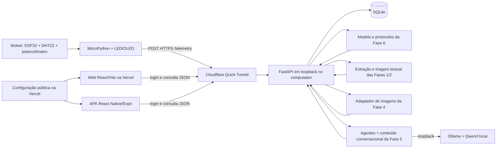

# Arquitetura da integração

## Componentes



O backend, o modelo preditivo, a triagem textual, o LLM local e o túnel HTTPS estão implementados. Web, APK e MicroPython ainda serão conectados. A arquitetura final de F7-18 será atualizada depois da validação fim a fim. O adaptador de imagens depende da recuperação do artefato treinado e retorna `503` enquanto indisponível.

## Escolhas de implementação

| Camada | Escolha | Motivo |
| --- | --- | --- |
| API | FastAPI / Python 3.12 | Contratos tipados e integração assíncrona com `run_pipeline` |
| Dados | SQLite, um processo da API | Histórico simples sem contratar banco remoto |
| Inferência numérica | Pipeline persistido da Fase 6 | Preservar transformação, features e classificação do experimento |
| Agentes/LLM | SDK já usado na Fase 6 e Ollama `qwen3:0.6b` | Reaproveitar execução local sem cobrança de API |
| Conversa | Fluxos exportados da Fase 5 e adaptador de texto | Preservar conteúdo e migrar a execução para o LLM local; não simular disponibilidade de Watson |
| IoT | ESP32 MicroPython, HTTPS JSON | Wokwi alcança a URL pública sem gateway privado pago |
| Atualização | Consulta periódica a cada 3 s | Compatível com Quick Tunnel e com os dois clientes |
| Web | React + Vite / Vercel Hobby | Atender ao deploy e CI/CD pedidos |
| Android | React Native + Expo / EAS Free | Gerar APK preview e instalar diretamente |

## Execução gratuita e disponibilidade

Backend, SQLite, modelos e Ollama serão executados no computador da demonstração. Apenas a API na porta local 8000 será disponibilizada pelo túnel HTTPS. A porta do Ollama, os diretórios do sistema e o banco não serão publicados diretamente.

A Web terá endereço Vercel estável; o backend de demonstração depende de computador ligado, internet e túnel ativo. Quick Tunnels têm endereço temporário, não oferecem garantia de disponibilidade e não são serviço de produção. A limitação deve constar na entrega e ser validada quanto ao acesso posterior do tutor. Nenhum serviço pago será contratado como alternativa automática.

Para evitar gerar outro APK quando o túnel mudar, Web e Mobile carregarão um documento público de configuração hospedado no mesmo domínio da Web:

```json
{
  "config_version": 1,
  "api_base_url": "https://ENDERECO-DO-TUNEL/api/v1"
}
```

Esse documento contém somente a URL pública, nunca senhas ou tokens. O endereço real será incluído apenas na publicação. O APK terá a URL Vercel da configuração em `EXPO_PUBLIC_CONFIG_URL`; a Web consultará `/runtime-config.json`. A mudança do túnel exige atualizar essa configuração por push e aguardar o deploy. Durante a demonstração, o processo do túnel deve permanecer ativo.

## Dados e consistência

- MicroPython envia temperatura e BPM a cada 3 segundos, com identificação do dispositivo, sessão de inicialização e sequência.
- O token do dispositivo determina o caso simulado associado. Um dispositivo não pode escolher outro caso no payload.
- SQLite conserva medições, contexto, previsões e análises com seus identificadores. `(device_id, boot_id, sequence)` é único para evitar duplicação em reenvios.
- A API calcula `fc_media` sobre até cinco leituras recentes válidas, em uma janela máxima de 15 segundos. O número real de amostras acompanha a previsão, inclusive no início da sessão.
- Temperatura e BPM vêm do simulador; as outras oito features são contexto sintético explícito. O painel identifica essa origem.
- Alteração do contexto incrementa sua revisão. Uma análise aponta para uma medição e uma revisão de contexto específicas, evitando apresentar resultado antigo como se fosse da leitura atual.
- Leituras fora do domínio do modelo permanecem visíveis; nenhuma delas é truncada para caber no treinamento. Sem entrada elegível, risco e classe ficam nulos com motivo informado.

## Processamento preditivo e conversacional

A inferência numérica é executada ao receber uma leitura elegível. A recomendação multiagente segue em tarefa separada, com estados `queued`, `running`, `completed` e `failed`.

Para não acumular chamadas ao LLM a cada 3 segundos, haverá uma tarefa em execução e uma solicitação pendente mais recente por caso. Durante o processamento, as novas leituras atualizam a previsão numérica; a pendência é substituída pela leitura mais recente. A fila global terá limite de 10 tarefas. Repetir uma solicitação para a mesma medição/revisão devolve a tarefa existente.

O painel mostra a leitura atual, a previsão atual e a referência/horário da última recomendação. Se forem diferentes, mostra que a recomendação corresponde a uma leitura anterior. O tempo do LLM depende da máquina; não será apresentado como latência garantida. Falha ou timeout não produz recomendação fictícia.

Conversas serão isoladas por usuário e sessão. O fluxo da Fase 5 fornecerá conteúdo; o módulo textual da Fase 2 poderá extrair os sintomas como contexto. Resultados textuais, numéricos e visuais serão apresentados em campos distintos.

## Acesso e configuração

Contas de demonstração com senha armazenada por hash, token de sessão com expiração de 1 hora e acesso aos casos autorizados. O token do dispositivo terá escopo de envio de telemetria para um caso simulado e poderá ser substituído. Os valores reais serão gerados na implementação e ficarão fora do GitHub.

Um projeto público Wokwi não deverá conter credencial de usuário ou segredo do backend. Se for necessário informar um token no simulador, ele será temporário, restrito a dados sintéticos e não salvo no projeto público. A forma de entrada do token precisa ser validada na lista IoT.

Antes do acesso externo, implementar autenticação, limites de requisição e validação de entrada. A API ficará em `127.0.0.1`; o túnel encaminhará somente essa porta. CORS deve listar origens Web autorizadas. O backend não confiará em CORS como mecanismo de autenticação.

## Referências verificadas em 10/11/2026

- [Cloudflare Quick Tunnels](https://developers.cloudflare.com/tunnel/get-started/quick-tunnels/): URL temporária, dependência do processo ativo e ausência de suporte a SSE. Por isso, foi escolhida consulta periódica.
- [Rede Wi-Fi ESP32 no Wokwi](https://docs.wokwi.com/guides/esp32-wifi): requisições HTTPS em MicroPython e gateway público sem acesso à rede local. Usar exclusivamente sinais sintéticos.
- [Vercel Hobby](https://vercel.com/docs/plans/hobby): modalidade gratuita para projetos pessoais e não comerciais, sujeita a limites.
- [Primeiro build Expo](https://docs.expo.dev/build/setup/): builds disponíveis para contas Free, sujeitos às condições e cotas do serviço.
